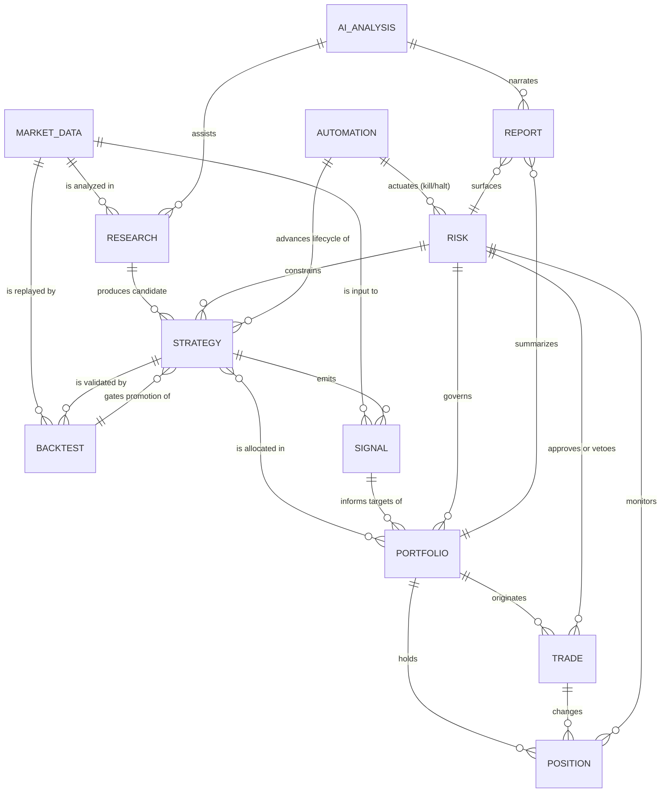
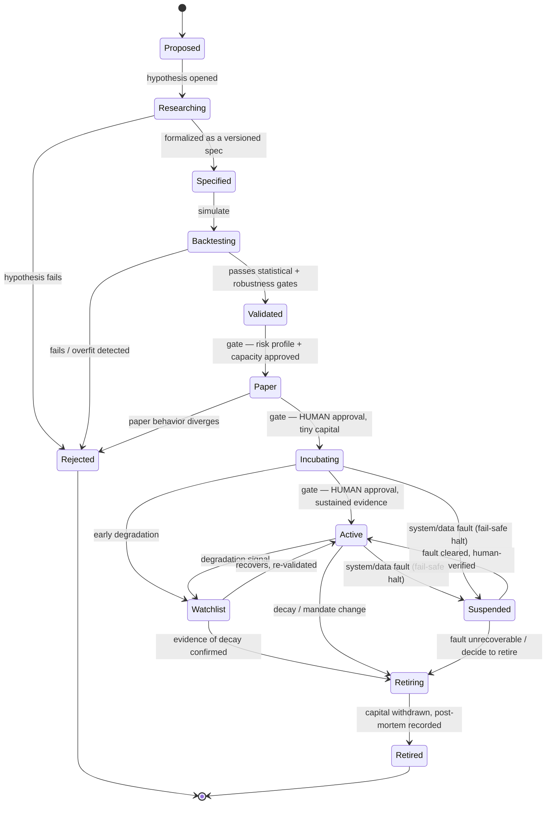

# Atlas — Domain Model

> **Status:** Ratified · Phase 1 (Foundation & Architecture)
> **Last updated:** 2026-07-05
> **Owner:** Atlas Division (operating within Jarvis)
> **Related:** [overview.md](overview.md) · [high-level-components.md](high-level-components.md) · [system-boundaries.md](system-boundaries.md) · [../principles.md](../principles.md)

---

## Purpose and rules

This document defines the **conceptual domain model** of Atlas: the core business concepts, their meaning, their key attributes, and how they relate. It is a *ubiquitous language* — every document, ADR, and future component uses these terms with these meanings.

**Two deliberate constraints, per Phase 1 scope:**
- This is a **conceptual** model, not a database schema. Attributes are described in prose/bullets; there is **no DDL, no migration, no physical data model** here. Physical modeling is a later-phase decision with its own ADR.
- Every domain concept is designed to be **immutable and traceable** where it influences capital — records are append-only and carry provenance ([principle 2.6/2.7](../principles.md)).

There are **twelve core domains**. They cluster into four groups: **Knowledge** (Market Data, Research, AI Analysis), **Strategy** (Strategies, Signals, Backtests), **Capital** (Portfolios, Positions, Trades), and **Governance** (Risk, Reports, Automation).

---

## 1. Domain map

*The diagram shows relationships, not cardinality precision; the authoritative meaning of each relationship is in the sections below.*

---

## 2. The twelve domains

### 2.1 Market Data *(Knowledge)*
**Meaning:** The point-in-time record of what was true and *known* in the market at each moment — prices/OHLCV, fundamentals, corporate actions, calendars, symbology, economic and (later) alternative data.
**Key attributes (conceptual):** instrument identity, timestamp, *as-of* (knowledge) time vs. *event* time, value, source/vendor, revision lineage, quality flags.
**Invariants:** strictly point-in-time via a **bitemporal** model (event time + knowledge/as-of time); corporate actions are represented as *new as-of records layered over* — never overwrites of — the original observations, so both "as it was known then" and "as adjusted later" stay queryable and reproducible; no look-ahead, no survivorship, no silent restatement; versioned and immutable; every downstream use references a specific **snapshot**.
**Relationships:** input to Research, Backtests, and Signals; the substrate everything else stands on.

### 2.2 Research *(Knowledge)*
**Meaning:** The documented process and artifacts of investigation — hypotheses, experiments, findings, and the reasoning behind candidate strategies.
**Key attributes:** hypothesis statement, rationale, data references (snapshots used), method, results, conclusion, status, author (human or AI-assisted).
**Invariants:** obeys point-in-time discipline; every candidate strategy traces to a stated hypothesis; findings are recorded whether positive or negative.
**Relationships:** consumes Market Data and AI Analysis; **produces candidate Strategies.**

### 2.3 AI Analysis *(Knowledge)*
**Meaning:** AI/ML-generated insights, narratives, rankings, anomaly flags, regime/degradation signals, and explanations — **advisory artifacts.**
**Key attributes:** claim/insight, cited evidence, confidence, generating model/version, timestamp, linked subject (a Strategy, Portfolio, Report, or Research item).
**Invariants:** advisory only — never an authority over capital ([system-boundaries §3.3](system-boundaries.md#33-atlas-is-not-a-magic-ai-stock-picker)); every claim carries citations and is auditable; subject to the same validation gates as any hypothesis.
**Relationships:** assists Research; narrates Reports; suggests to Strategy — never commands.

### 2.4 Strategies *(Strategy — the central entity)*
**Meaning:** A **versioned specification** of a trading approach — universe, entry/exit logic, sizing intent, parameters, constraints, capacity — together with its **lifecycle state.** The organizing entity of Atlas.
**Key attributes:** identity, version, specification, hypothesis link, lifecycle state, evidence links (backtests), risk profile/limits, **capacity limit** (a participation-rate-derived *hard ceiling* on AUM, not just an estimate), **pre-declared performance envelope** (expected return/vol/Sharpe distribution and the max expected drawdown *depth and duration* at stated confidence — the yardstick that makes decay measurable versus noise), **regime-coverage** (which market regimes the out-of-sample window actually spanned; unproven regimes are flagged), **selection-adjusted expectancy** (haircut for survivor/multiple-testing bias), provenance, post-mortem (if retired).
**Invariants:** immutable per version (changes create new versions); cannot hold capital without having passed its lifecycle gates; always carries a current lifecycle state (see [§3](#3-the-strategy-lifecycle)).
**Relationships:** emitted from Research; **emits Signals**; validated by Backtests; allocated within Portfolios; constrained by Risk; advanced by Automation.

### 2.5 Signals *(Strategy)*
**Meaning:** The time-stamped **outputs** of a strategy — a desired action, direction, target weight, or score for an instrument at a moment.
**Key attributes:** strategy+version reference, instrument, timestamp, signal value (e.g. target weight / direction / score), the data snapshot that produced it, rationale.
**Invariants:** deterministic given (strategy version × data snapshot); traceable to its producing strategy and inputs; in backtests, subject to the same point-in-time rules as live.
**Relationships:** produced by Strategies from Market Data; consumed by Portfolio to form targets; replayed within Backtests.

### 2.6 Backtests *(Strategy)*
**Meaning:** A **simulation run** — the evaluation of (strategy version × data window × cost/market assumptions × seed) producing performance/risk evidence.
**Key attributes:** strategy+version, data snapshot/window, assumptions (costs/slippage/liquidity), seed, metrics (return, risk, expectancy, drawdown, Sharpe/Sortino/Calmar), statistical verdicts (significance, overfitting probability), equity curve, simulated trade log, full provenance.
**Invariants:** **reproducible by class** ([ADR 0005](../adr/0005-point-in-time-and-reproducible-research.md) — bit-for-bit for the deterministic path); produces *evidence, not decisions*; never touches live capital. Every execution (including parameter sweeps and abandoned variants) increments a persistent, append-only **trial counter** keyed to a research *family*; multiplicity corrections (deflated metrics, probability-of-backtest-overfitting) consume the **family-level** trial count, not the per-strategy count — otherwise the correction is decorative ([F-C6](../failure-criteria.md#category-c--process--discipline-failures)).
**Relationships:** consume Market Data and Strategies; **gate the lifecycle promotion** of Strategies.

### 2.7 Portfolios *(Capital)*
**Meaning:** A managed **book of capital** — an allocation across validated strategies, holding positions and pursuing target exposures within a risk mandate.
**Key attributes:** identity, capital base, per-strategy allocations, target vs. actual positions, aggregate exposures, P&L, attribution, mandate/limits reference.
**Invariants:** allocates only to *validated* strategies; operates within its Risk mandate; targets are *proposals* subject to the Risk gate before Execution.
**Relationships:** contains Strategies (allocations) and **holds Positions**; **originates Trades** (via targets); governed by Risk; summarized in Reports.

### 2.8 Positions *(Capital)*
**Meaning:** A current **holding** within a portfolio — an instrument, quantity, cost basis, and market value at a point in time.
**Key attributes:** portfolio reference, instrument, quantity, average cost, market value, unrealized P&L, owning strategy attribution.
**Invariants:** results *only* from executed Trades (never conjured); continuously monitored by Risk; reconcilable against the broker's record ([execution §3.7](overview.md#37-execution-layer)).
**Relationships:** held within Portfolios; changed by Trades; monitored by Risk.

### 2.9 Trades *(Capital)*
**Meaning:** An **executed transaction** — a fill (or set of fills) that changed a position. The atomic, immutable record of money moving.
**Key attributes:** identity, order reference, instrument, side, quantity, price, fees/costs, timestamp, broker reference, originating signal/target, risk approval reference, human approval reference (if applicable).
**Invariants:** immutable and append-only; **fully traceable** end-to-end (fill → order → risk approval → portfolio target → signal → strategy version → data snapshot); every trade carries a recorded rationale ([principle 2.7](../principles.md#27-full-traceability-lineage)).
**Relationships:** originated by Portfolio targets; approved/vetoed by Risk; change Positions; feed Reports and P&L.

### 2.10 Risk *(Governance — cross-cutting authority)*
**Meaning:** The **limits, policies, metrics, and decisions** that constrain everything — position/strategy/portfolio/system limits, sizing rules, drawdown controls, exposure/correlation/concentration limits, VaR/CVaR/stress, circuit breakers, and the kill-switch state — plus each approval/veto/alert.
**Key attributes:** limit definitions and scopes, current risk metrics, approval/veto decisions (with reasons), breach records, override records (who/when/why), circuit-breaker and kill-switch state.
**Invariants:** independent of value-seeking and execution ([separation of duties](../principles.md#23-separation-of-duties)); may only *reduce or block* risk; every decision is recorded; only a logged human override can relax a limit.
**Relationships:** governs Portfolios; approves/vetoes Trades; monitors Positions; constrains Strategies; actuated by Automation for halts/kills.

### 2.11 Reports *(Governance)*
**Meaning:** Derived **intelligence artifacts** — dashboards, performance/attribution reports, risk summaries, audit exports, and narrative intelligence for the operator.
**Key attributes:** subject/scope, period, contents/metrics, source references, generating time, linked AI narrative, methodology note.
**Invariants:** read-only and faithful — no methodology drift, no rosy distortion ([failure F-B6](../failure-criteria.md)); every figure traces to a source.
**Relationships:** summarize Portfolios and surface Risk; narrated by AI Analysis; delivered via Jarvis Integration.

### 2.12 Automation *(Governance)*
**Meaning:** The **rules and orchestration** by which Atlas runs itself — lifecycle-promotion rules, scheduled jobs (data refresh, rebalancing triggers, monitoring, drills), and the **trading-enable/disable and approval/kill state.** The "how Atlas operates" domain.
**Key attributes:** rule/trigger definitions, schedules, current automation state (enabled/paused/killed), autonomy mandate/level, approval-workflow state, actuation records.
**Invariants:** bounded by human governance — automation may act only within an explicitly granted mandate ([charter](../automated-trading-charter.md)); every actuation is recorded; the kill switch overrides all automation.
**Relationships:** advances Strategy lifecycle (within gates); actuates Risk halts/kills; scheduled around all layers.

---

## 3. The strategy lifecycle

The **strategy lifecycle** is the beating heart of the domain model — the state machine every strategy travels, governed by **pre-declared evidence gates** ([principle 3.3](../principles.md#33-evidence-gates-not-vibes-promote-strategies)). It operationalizes the [mission](../mission.md): *continuously discover, test, validate, deploy, monitor, and retire.*

### Lifecycle states

| State | Capital | Meaning | Gate to advance |
|---|:---:|---|---|
| **Proposed** | none | An idea exists | Open a research hypothesis |
| **Researching** | none | Under structured investigation | Formalize into a versioned spec |
| **Specified** | none | A precise, versioned strategy spec exists | Enter backtesting |
| **Backtesting** | none | Under simulation and validation | Pass statistical significance **and** robustness/overfitting gates |
| **Validated** | none | Believable evidence of edge exists | Risk-profile + capacity approval |
| **Paper** | none | Trading on paper against live plumbing | **Human** approval + paper matches expectation |
| **Incubating** | **tiny** | Live at trivial size, human-in-the-loop | **Human** approval + sustained live evidence |
| **Active** | **full (bounded)** | Live within mandate | — (monitored continuously) |
| **Watchlist** | reduced | Degradation suspected; de-risked | Re-validate (→Active) or confirm decay (→Retiring) |
| **Suspended** | held (frozen) | Live capital, trading **paused by a system/data fault** (distinct from decay) — auto-entered on a fail-safe halt | Human-verified fault cleared → resume, or → Retiring |
| **Retiring** | winding down | Capital being withdrawn | Complete withdrawal |
| **Retired** | none | Removed from the book | Terminal; post-mortem recorded |
| **Rejected** | none | Failed a gate at any stage | Terminal; reason recorded |

### Lifecycle invariants
- **No skipping gates.** A strategy cannot reach a capital-bearing state without passing every prior gate; any exception is a logged human override, never a silent bypass ([failure F-C1/F-C2](../failure-criteria.md)).
- **Gates are declared before results are seen — verifiably.** Each strategy's gates are committed to the immutable [Configuration & Limits Registry](high-level-components.md#1-cross-cutting-components-the-spine) with a timestamp *before* its first out-of-sample backtest runs, so "declared before results" is cryptographically checkable, not a promise — defeating goalpost-moving ([F-C2](../failure-criteria.md#category-c--process--discipline-failures)).
- **Human approval is mandatory** for every transition that increases capital (Paper→Incubating, Incubating→Active), per the [charter](../automated-trading-charter.md).
- **Degradation is expected**, not exceptional: Active→Watchlist→Retiring is a normal, healthy path, not a failure. But retirement requires breaching the strategy's **pre-declared performance envelope** (§2.4), not mere noise, so healthy strategies are not killed by variance ([F-C8](../failure-criteria.md#category-c--process--discipline-failures)).
- **Fault ≠ decay.** `Suspended` (a system/data fault, auto-entered as a [fail-safe default](../adr/0008-fail-safe-defaults-and-kill-switch.md)) is distinct from `Watchlist`/`Retiring` (edge decay); leaving `Suspended` requires human verification, not just time.
- **Immutable versions & supersession.** A strategy is immutable per version; *improving* a live strategy means promoting a new version (v2) through the normal gates while v1 winds down (Retiring), with an explicit, audited capital handoff — never an in-place mutation of live capital.
- **Retirement always produces a post-mortem** — the system learns from every death ([principle 3.6](../principles.md)).
- **Every transition is immutable and audited** (who/what/when/why).

---

## 4. Aggregate ownership & boundaries

To keep the model clean, each domain has a clear **owner layer** ([overview](overview.md)) responsible for its integrity:

| Domain | Owning layer |
|---|---|
| Market Data | Data |
| Research | Research |
| AI Analysis | AI Intelligence |
| Strategies, Signals | Strategy |
| Backtests | Backtesting |
| Portfolios, Positions | Portfolio |
| Trades | Execution (created), Portfolio (reflected) |
| Risk | Risk |
| Reports | Reporting |
| Automation | Automation (orchestration), governed by Risk + human |

Cross-domain references are by **stable identity + version**, never by copying mutable state — so lineage stays intact and any entity can be traced to its exact inputs.

---

## 5. Why this model serves the mission

- **Strategy-centric, lifecycle-driven** — models Atlas as a *factory of strategies*, not a holder of one strategy ([vision](../vision.md)).
- **Evidence is a first-class citizen** (Backtests, AI Analysis) and is *separated* from decisions (Automation/Portfolio) and *authority* (Risk, human).
- **Capital concepts (Portfolio/Position/Trade) are immutable and fully traceable**, satisfying auditability and survival requirements.
- **Governance is modeled explicitly** (Risk, Automation, Reports) rather than being an afterthought — because in Atlas, governance *is* the product.
