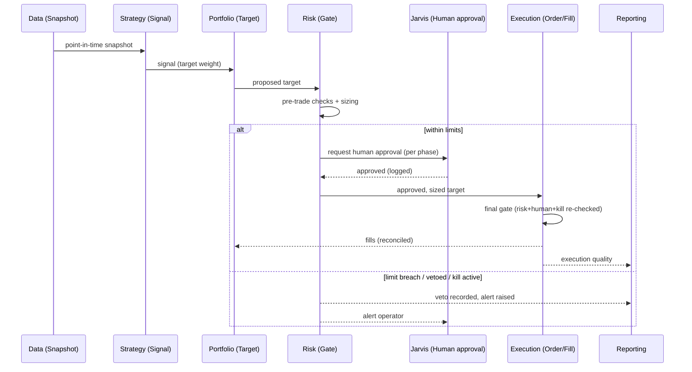

# Atlas — High-Level Components

> **Status:** Ratified · Phase 1 (Foundation & Architecture)
> **Last updated:** 2026-07-05
> **Owner:** Atlas Division (operating within Jarvis)
> **Related:** [overview.md](overview.md) · [domain-model.md](domain-model.md) · [non-functional-requirements.md](non-functional-requirements.md)

---

## Purpose

[overview.md](overview.md) defines the ten *layers* and their contracts. This document decomposes each layer into its **major components** — the logical building blocks and the responsibilities each holds — plus the **cross-cutting components** that every layer relies on. It is a *conceptual* component map: no code, no APIs, no technology choices (those are later-phase ADRs). Its job is to make the architecture concrete enough to reason about and to review.

A recurring pattern across the system: **every external dependency sits behind an Adapter**, and **every capital-relevant action passes through a Gate** and writes to the **Audit/Provenance** spine.

---

## 1. Cross-cutting components (the spine)

These are used by every layer and are the backbone of Atlas's integrity guarantees.

| Component | Responsibility |
|---|---|
| **Audit Log** | Append-only, immutable, tamper-evident record of every decision, order, fill, config change, override, and lifecycle transition — the who/what/when/why. |
| **Provenance / Lineage Service** | Stamps every artifact (snapshot, signal, backtest, trade, report) with the inputs and code version that produced it, enabling end-to-end tracing and reproducibility. |
| **Time Authority** | The single source of "as-of" time; enforces point-in-time correctness and the event-time vs. knowledge-time distinction across all layers. |
| **Identity & Secrets Broker** | Mediates credentials (broker, vendor, model) from Jarvis/vault to the components that need them, under least privilege; isolates money-touching credentials. |
| **Kill Switch & Circuit-Breaker Controller** | Always-available control that halts trading and drives the system to its fail-safe state; owned conceptually by Risk, actuated by Automation, triggerable by the operator. |
| **Configuration & Limits Registry** | Versioned, audited store of risk limits, mandates, gates, and system config; every change is recorded and attributable. |
| **Observability Substrate** | Metrics, structured logs, traces, and health checks feeding Reporting and alerting. |

These components realize [principles](../principles.md) 2.1, 2.2, 2.6, 2.7, and 2.8 directly; they are built early because everything else depends on them.

---

## 2. Components by layer

### 2.1 Data Layer
- **Vendor Adapters** — one per data source, behind a common interface; isolate vendor quirks.
- **Ingestion & Normalization** — bring raw feeds into canonical form (symbology, units, calendars).
- **Point-in-Time Store** — versioned, as-of-aware storage; the single source of truth.
- **Corporate-Actions & Universe Engine** — splits/dividends/mergers; survivorship-bias-free universes.
- **Data-Quality Monitor** — completeness, staleness, outlier, and drift checks; can raise a halt signal.
- **Snapshot Service** — produces immutable, referenceable data snapshots for research/backtests.

### 2.2 Research Layer
- **Research Workbench** — the (human + AI) environment for exploration and hypothesis formation.
- **Feature / Signal Library** — reusable, documented, point-in-time-correct feature definitions.
- **Hypothesis Registry** — records every hypothesis, its rationale, and its outcome (including failures).
- **Candidate Builder** — packages a validated hypothesis into a proposed strategy specification.

### 2.3 Strategy Layer
- **Strategy Specification Model** — the versioned, precise definition of a strategy (as config/spec).
- **Strategy Registry** — catalog of all strategies, versions, states, and provenance.
- **Lifecycle State Machine** — enforces the [strategy lifecycle](domain-model.md#3-the-strategy-lifecycle) and its gates.
- **Evidence-Gate Evaluator** — checks a strategy's evidence against pre-declared promotion criteria.

### 2.4 Backtesting Layer
- **Simulation Engine** — deterministic, point-in-time replay of a strategy over historical data.
- **Cost & Market-Impact Models** — realistic, conservative transaction cost, slippage, and liquidity.
- **Validation Suite** — walk-forward, out-of-sample, cross-validation, Monte-Carlo, stress.
- **Overfitting Detector** — multiple-testing correction, deflated metrics, probability-of-backtest-overfitting.
- **Reproducibility Harness** — captures/replays provenance to guarantee bit-for-bit results.

### 2.5 Risk Layer
- **Limit Engine** — position/strategy/portfolio/system limits and their evaluation.
- **Pre-Trade Risk Gate** — approves, sizes down, or vetoes each proposed target/order.
- **Sizing Service** — fractional-Kelly-with-haircut and volatility-target position sizing.
- **Exposure, Correlation & Factor Monitor** — concentration limits, **stressed/tail-correlation** (conditional on down-tail regimes, not average pairwise), and **common-factor exposure aggregation** that catches "ten strategies, one hidden factor" — the actual mechanism of a [correlated blow-up](../failure-criteria.md#category-a--survival-failures).
- **Drawdown & Circuit-Breaker Controller** — drawdown-triggered de-risking and system halts.
- **Tail-Risk & Stress Engine** — VaR/CVaR and scenario/stress evaluation.
- **Risk Ledger** — records every approval, veto, breach, and override.

### 2.6 Portfolio Layer
- **Meta-Allocator** — allocates capital across validated strategies (the book view).
- **Target Constructor** — aggregates signals + allocations into desired positions (proposals).
- **Rebalancing Planner** — decides when/how to move from actual → target within limits.
- **P&L & Attribution Engine** — tracks performance and attributes it to strategies/factors.
- **Reconciliation View** — Atlas's book of record, reconciled against Execution/broker.

### 2.7 Execution Layer
- **Broker Adapters** — one per broker/venue, behind a common interface; isolate broker quirks; require broker-side idempotency-key support as a selection criterion.
- **Order-Intent Log** — durable write-ahead record of order intent *before* submission; enables crash-in-flight recovery (was it placed?) and, with idempotency keys, prevents phantom/duplicate orders ([F-E8](../failure-criteria.md#category-e--system--operational-failures)).
- **Order Manager** — full order lifecycle (create/route/amend/cancel/fill).
- **Execution Algorithms** — TWAP/VWAP/limit/participation, sized to Atlas's low/mid-frequency cadence.
- **Final Gate Enforcer** — re-checks risk approval, human approval, and kill-switch state at the point of action.
- **Fill & Reconciliation Handler** — captures fills, reconciles against the broker, feeds Portfolio/Risk.

### 2.8 Reporting Layer
- **Dashboard Service** — current state of book, risk, strategies, and system health.
- **Report Composer** — periodic and on-demand performance/risk/attribution/audit reports.
- **Alerting Service** — routes severity-tagged alerts (risk, anomaly, degradation, incident) to Jarvis.
- **Audit-Trail Presenter** — human-readable, exportable views over the immutable Audit Log.

### 2.9 AI Intelligence Layer
- **Model Adapters** — LLM/ML providers behind a common interface (via Jarvis shared services).
- **Insight & Narrative Engine** — plain-language explanations and cited intelligence reports.
- **Regime & Degradation Detector** — flags regime shifts and per-strategy decay signals.
- **Anomaly Detector** — surfaces "this looks wrong" across data, behavior, and results.
- **Research Assistant** — idea generation and literature synthesis (advisory input to Research).
- **Explainability & Injection Guardrails** — force citations that *resolve to hash-referenced records* (unverifiable/hallucinated citations are **stripped, not shown**); attach confidence and provenance; treat all LLM inputs as untrusted (prompt-injection / data-poisoning); and block any path from AI output to capital that skips validation, risk, and human governance ([threat model §4.3](threat-model.md#43-ai-as-an-injection-surface-into-capital-t5--asset-6)).

### 2.10 Jarvis Integration Layer
- **Anti-Corruption Adapter** — translates between Atlas's domain and Jarvis's OS concepts ([ADR 0007](../adr/0007-jarvis-anti-corruption-layer.md)).
- **Command & Query Router** — routes operator commands/queries to the right Atlas capability.
- **Approval Workflow Handler** — routes capital/mandate approval requests to the operator and captures responses.
- **Notification Bridge** — hands Atlas alerts/reports to Jarvis for delivery.
- **Kill-Switch Endpoint** — the operator's always-available halt control, wired to the Kill-Switch Controller.
- **Auth & Session Consumer** — consumes Jarvis identity/authorization; enforces authority boundaries.

---

## 3. Component interaction: a trade's journey (illustrative)

To show how components compose, here is the path of a single (future, post-Phase-7) live trade — every step recorded on the Audit/Provenance spine:

Note the defenses in depth: risk is checked at the gate **and re-checked** at execution; human approval is explicit and logged; the kill switch is honored at the last possible moment; and every arrow writes to the Audit Log. This is [fail-safe, separated-duty](../principles.md) design made concrete.

---

## 4. Design notes

- **Adapters everywhere externals live** (data, brokers, models) preserve the 10-year replaceability requirement ([principle 2.9](../principles.md)).
- **Gates and the spine are non-bypassable.** A component cannot reach a broker except through the Final Gate Enforcer, and cannot act on capital without writing to the Audit Log.
- **The AI layer is deliberately "boxed."** Its Explainability Guardrails ensure it can inform and explain but has *no wire* to capital that skips validation and human governance.
- **Components are logical, not physical.** How they are packaged, deployed, and scaled is a later-phase decision recorded in its own ADR — Phase 1 fixes *what exists and why*, not *how it is deployed*.
