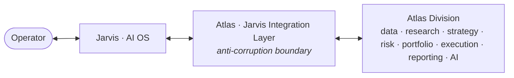

# Atlas — Jarvis Integration

> **Status:** Ratified · Phase 1 (Foundation & Architecture)
> **Last updated:** 2026-07-05
> **Owner:** Atlas Division (operating within Jarvis)
> **Related:** [overview.md](overview.md) · [system-boundaries.md](system-boundaries.md) · [../mission.md](../mission.md) · [../adr/0007-jarvis-anti-corruption-layer.md](../adr/0007-jarvis-anti-corruption-layer.md)

---

## 1. The relationship

**Jarvis is an AI Operating System. Atlas is its Quantitative Trading & Investment Division.** The relationship is deliberately that of an *operating system and a specialist division*, not a monolith and a plugin:

- **Jarvis** is the operator's console and the platform: identity, the natural-language interface, notifications, scheduling, secrets, and the general-purpose AI substrate. Jarvis is *where the operator stands.*
- **Atlas** is the domain expert Jarvis delegates all investment matters to: research, strategy, risk, portfolio, execution, and intelligence. Atlas is *where the money is reasoned about.*

An analogy: if Jarvis is the operator's chief of staff, Atlas is the CIO's quant division reporting through that chief of staff. The operator rarely talks to Atlas "directly"; they talk to Jarvis, which routes investment matters to Atlas and brings back Atlas's answers, alerts, and approval requests.

## 2. Core integration principle: loose coupling via an anti-corruption layer

All traffic between Atlas and Jarvis crosses **one boundary** — the [Jarvis Integration Layer](overview.md#310-jarvis-integration-layer), an **anti-corruption layer (ACL)** ([ADR 0007](../adr/0007-jarvis-anti-corruption-layer.md)). This is a hard architectural commitment for a 10-year system:

- **Atlas's internal domain model is never exposed raw to Jarvis, and vice-versa.** The ACL translates between the two vocabularies.
- **Either side can evolve independently.** Jarvis can be re-platformed; Atlas can restructure internally; only the contract at the ACL must be honored.
- **Atlas can, in principle, run semi-independently.** If Jarvis is unavailable, Atlas must *fail safe* (halt new trading, keep monitoring/protecting existing positions) rather than behave undefined ([§6](#6-degraded-mode-what-happens-if-jarvis-is-unavailable)).
- **The boundary is the single place** where authentication, authorization, and the human-approval workflow are enforced for operator interactions.

## 3. What Jarvis provides to Atlas

Atlas consumes these platform capabilities rather than building its own:

| Capability | What Atlas uses it for |
|---|---|
| **Identity & authentication** | Knowing it is truly the operator issuing a command/approval. |
| **Authorization context** | Enforcing authority boundaries ([system-boundaries §4](system-boundaries.md#4-authority-boundaries-who-is-allowed-to-do-what)). |
| **Natural-language interface** | The operator asks/commands Atlas in plain language via Jarvis. |
| **Notification & messaging transport** | Delivering Atlas's alerts and reports to the operator. |
| **Scheduling / orchestration triggers** | Kicking off data refreshes, monitoring, drills, rebalancing windows. |
| **Secrets / key custody** | Sourcing broker/vendor/model credentials securely (never hard-coded in Atlas). |
| **Shared AI / LLM services** | The substrate for the [AI Intelligence layer](overview.md#39-ai-intelligence-layer). |
| **Human-approval routing** | Carrying capital/mandate approval requests to the operator and back. |

## 4. What Atlas exposes to Jarvis

Atlas presents a **capability contract** to Jarvis — a stable set of things Jarvis can ask for or be told, expressed in Jarvis's terms by the ACL. Conceptually (not as an API spec — that is a later phase):

**Queries Jarvis can make (read):**
- *Status* — "What is Atlas doing? What is the book, the risk, the P&L right now?"
- *Explanation* — "Why is this position held? Why was this trade made / this strategy retired?"
- *Intelligence* — "Give me the latest intelligence report / risk summary / opportunity ranking."
- *Strategy state* — "What strategies are live, incubating, on watchlist, retired, and why?"

**Commands Jarvis can issue (write, authority-checked):**
- *Governance* — set/adjust the mandate and risk limits (logged).
- *Approvals* — approve/deny a capital or mandate-escalation request.
- *Control* — pause, resume, de-risk, or **kill** (halt all trading).
- *Direction* — commission research on a theme; prioritize/deprioritize.

**Events Atlas raises to Jarvis (push):**
- *Approval requests* — "Strategy X requests promotion to live capital; here is the evidence."
- *Alerts* — risk-limit proximity/breach, anomaly, degradation, incident (severity-tagged).
- *Reports* — scheduled intelligence and performance/risk reports.
- *Confirmations* — trade/rebalance summaries and post-mortems.

Every write from Jarvis and every event from Atlas is **authenticated, authority-checked, and recorded** on the audit spine.

## 5. Key interaction flows

### 5.1 Human approval of a capital escalation *(the most important flow)*
1. A strategy passes its evidence gates and reaches a capital-increasing transition ([lifecycle](domain-model.md#3-the-strategy-lifecycle)).
2. Atlas raises an **approval request** through the ACL: the proposal + its evidence + its risk profile, in plain language.
3. Jarvis presents it to the operator and returns an authenticated **approve/deny** (with any conditions).
4. The decision is recorded immutably; only on explicit approval does the strategy advance. **Silence ≠ approval** ([fail-safe](../adr/0008-fail-safe-defaults-and-kill-switch.md)).

### 5.2 Operator asks "what and why"
1. Operator asks Jarvis in natural language.
2. ACL routes to Reporting/AI Intelligence, which assemble a cited, traceable answer.
3. Jarvis renders it. The answer is grounded in the audit trail — no unsourced claims.

### 5.3 Kill switch
1. Operator triggers **kill** via Jarvis (or an automated circuit breaker fires internally).
2. The ACL's Kill-Switch Endpoint actuates the Kill-Switch Controller immediately.
3. Trading halts; positions move to the fail-safe posture; the event is recorded and confirmed back. The kill path is **the highest-priority, most-tested path in the system** ([automated-trading-charter.md](../automated-trading-charter.md)).

## 6. Degraded mode: what happens if Jarvis is unavailable

Because Atlas must *fail safe*, its behavior when the Jarvis boundary is degraded is defined, not undefined:

- **No new risk is taken.** Capital-increasing actions require human approval that flows through Jarvis; if that path is down, those actions **cannot proceed** — they queue or are declined.
- **Protection continues.** Monitoring, risk enforcement, drawdown de-risking, and the kill switch must remain functional for *existing* positions even if the operator interface is unreachable — Atlas never goes *blind* to live money ([NFR reliability](non-functional-requirements.md#1-reliability)).
- **Everything is queued and reconciled.** Alerts and reports buffer and deliver when the boundary recovers; nothing is lost.
- **The kill switch has an independent path.** The ability to *halt* must not depend on a healthy Jarvis — which means authenticating the operator's kill and sourcing the flatten credential must both work when Jarvis is down. This requires a pre-provisioned, tightly-scoped **standing kill/flatten credential** (not fetched from Jarvis at the moment of use). It is a hard [Phase-7 requirement](../roadmap.md#phase-7--shadow--paper-execution); until it exists and is drilled, **no live capital is permitted** ([charter §6](../automated-trading-charter.md#6-kill-switch-requirements)). Note the honest limit: a *halt* is always achievable, but a *flatten* remains best-effort against a closed/illiquid market.

## 7. Boundary responsibilities summary

| Concern | Jarvis side | Atlas side (ACL) |
|---|---|---|
| Authentication | Establishes operator identity | Trusts only authenticated identity |
| Authorization | Provides auth context | Enforces authority boundaries |
| Language | Parses/render natural language | Translates to/from domain terms |
| Approvals | Presents request, captures decision | Blocks capital until decision returns |
| Secrets | Custodies credentials | Consumes under least privilege |
| Notifications | Delivers | Produces, severity-tags |
| Evolution | May change freely behind contract | May change freely behind contract |

## 8. Why this design serves the mission

- **Separation of concerns:** Atlas focuses on *quant + risk + execution*; Jarvis focuses on *interface + identity + orchestration.* Neither reimplements the other.
- **Governance lives at the boundary:** the single ACL is exactly where human authority, approvals, and the kill switch are enforced — making the human-in-the-loop guarantee ([principle 3.1](../principles.md)) structurally real.
- **Longevity:** loose coupling protects a 10-year system from being trapped by either side's technology choices.
- **Safety:** a defined degraded mode means the *failure of the interface never becomes the failure of risk control.*
