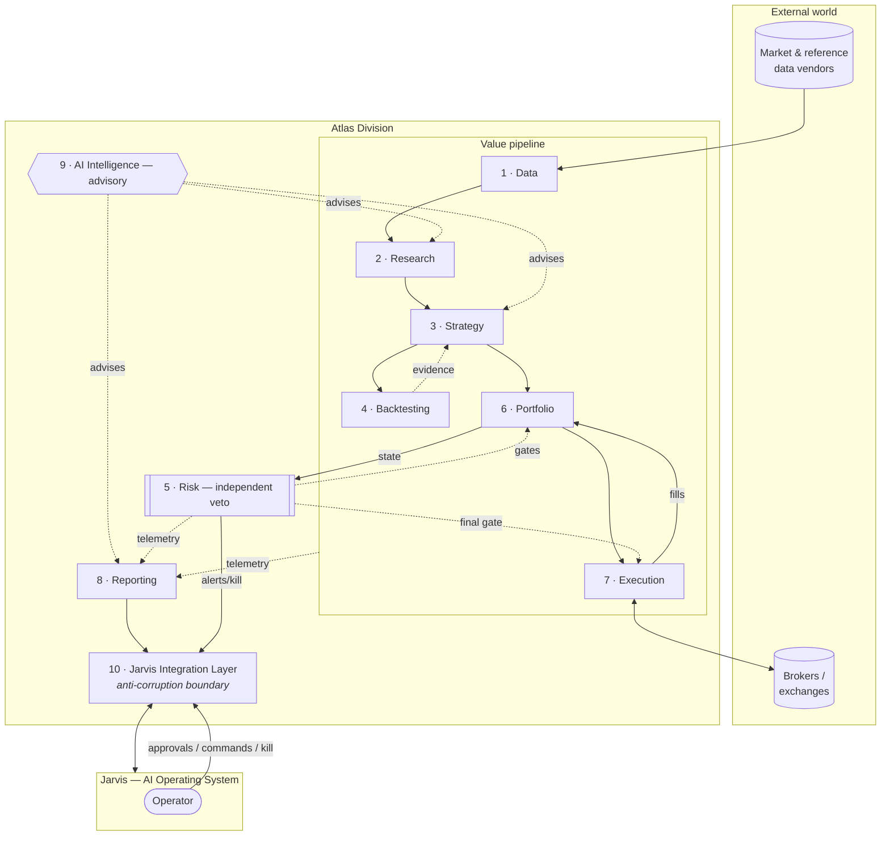

# Atlas — Architecture Overview

> **Status:** Ratified · Phase 1 (Foundation & Architecture)
> **Last updated:** 2026-07-05
> **Owner:** Atlas Division (operating within Jarvis)
> **Related:** [system-boundaries.md](system-boundaries.md) · [domain-model.md](domain-model.md) · [high-level-components.md](high-level-components.md) · [jarvis-integration.md](jarvis-integration.md) · [non-functional-requirements.md](non-functional-requirements.md) · [../principles.md](../principles.md) · [ADR 0018 — Open-Source Integration Boundary](../adr/0018-open-source-integration-boundary.md)

---

## 1. Architectural intent

Atlas is architected as a **layered strategy-lifecycle engine** with an **independent risk authority** and a **single, tightly governed path to real money**. The architecture is a direct expression of the [principles](../principles.md): point-in-time honesty, separation of duties, fail-safe defaults, defense in depth, full traceability, and loose coupling to Jarvis.

The design optimizes for **correctness, auditability, robustness, and a 10-year lifespan** — explicitly *not* for ultra-low latency ([ADR 0006](../adr/0006-not-high-frequency-trading.md)). This single stance simplifies enormous swaths of the system: Atlas can prefer clear, verifiable, immutable designs over the exotic engineering an HFT arms race would demand.

Three structural commitments define the whole architecture:

1. **The pipeline shape.** Value flows in one primary direction — *data → research → strategy → backtest → portfolio → execution* — with **risk as a cross-cutting gate** and **reporting/AI as cross-cutting observers**. This makes reasoning, testing, and tracing tractable.
2. **Risk is not in the value-seeking path; it stands beside it with a veto.** No component can authorize its own risk ([ADR 0003](../adr/0003-risk-as-independent-veto.md)).
3. **Only one component ever touches a broker.** Execution is the sole boundary to real money, and it enforces the final risk gate, the human-approval gate, and the kill switch at the point of action.

---

## 2. The ten layers at a glance

Atlas is organized into ten layers. The first eight form the **value pipeline** (plus the risk gate); the last two are **cross-cutting** — AI Intelligence advises across all layers, and Jarvis Integration is the outer boundary to the operator's world.

| # | Layer | One-line responsibility | Touches real money? |
|---|-------|------------------------|:---:|
| 1 | [Data](#31-data-layer) | Trustworthy, point-in-time single source of truth | No |
| 2 | [Research](#32-research-layer) | Turn data + ideas into documented hypotheses | No |
| 3 | [Strategy](#33-strategy-layer) | Formalize hypotheses into versioned strategy specs + lifecycle | No |
| 4 | [Backtesting](#34-backtesting-layer) | Produce believable evidence via realistic, reproducible simulation | No |
| 5 | [Risk](#35-risk-layer) | Independently constrain risk at every level; hold the veto | No (governs) |
| 6 | [Portfolio](#36-portfolio-layer) | Construct and manage the book; allocate capital across strategies | No (decides targets) |
| 7 | [Execution](#37-execution-layer) | Turn approved targets into orders; the sole path to a broker | **Yes** |
| 8 | [Reporting](#38-reporting-layer) | Observe and communicate truth; audit, attribution, alerts | No |
| 9 | [AI Intelligence](#39-ai-intelligence-layer) | Cross-cutting advisory analysis and explanation | No (advises only) |
| 10 | [Jarvis Integration](#310-jarvis-integration-layer) | The governed boundary to Jarvis and the operator | No (routes) |

## 2.1 System diagram

*Read the diagram as: data enters at the bottom-left, evidence gates promotion inside Strategy, Portfolio proposes targets, Risk gates them, Execution is the only door to the broker, and everything reports upward through Reporting → Jarvis Integration → the operator. Risk and the operator can halt the flow at any time.*

---

## 3. The layers in detail

Each layer is specified by its **Responsibilities, Inputs, Outputs, Boundaries,** and **Dependencies** — the contract that keeps layers decoupled and independently testable. (Component-level internals live in [high-level-components.md](high-level-components.md); the entities that flow between layers live in [domain-model.md](domain-model.md).)

### 3.1 Data Layer

- **Responsibilities:** Ingest, normalize, validate, version, and serve all market and reference data as the single source of truth. Guarantee **point-in-time correctness** (no look-ahead, no survivorship bias, no silent restatement). Handle corporate actions, calendars/holidays, symbology, and continuous data-quality monitoring. Abstract away individual vendors.
- **Inputs:** External vendor feeds (prices/OHLCV, fundamentals, corporate actions, economic/reference data, and — later — alternative/news data); vendor APIs and files.
- **Outputs:** Clean, normalized, versioned, point-in-time datasets and snapshots to Research, Strategy, and Backtesting; data-quality metrics and freshness/staleness signals to Risk and Reporting.
- **Boundaries:** Does **not** interpret data, generate signals, or make decisions. Does not talk to brokers. Owns "what was true and known, when." A data-quality failure here must be able to *halt* downstream trading, never be silently passed through.
- **Dependencies:** External data vendors (behind an abstraction); storage/compute infrastructure (Atlas-owned or Jarvis-provided).

### 3.2 Research Layer

- **Responsibilities:** Exploratory analysis, hypothesis generation, feature/signal discovery, factor research, literature integration, and idea capture. The disciplined "laboratory" where humans and the AI layer explore. Every candidate strategy is born here as a *documented hypothesis*.
- **Inputs:** Point-in-time data from the Data layer; research questions from the operator (via Jarvis) and from the AI layer; academic/industry knowledge.
- **Outputs:** Documented hypotheses, feature/signal definitions, and candidate strategy proposals — with their rationale and expected behavior — handed to the Strategy layer.
- **Boundaries:** Research output is a **hypothesis, never a deployed strategy.** No live capital, no production authority. Research must obey point-in-time discipline just as strictly as backtesting, or its ideas are poisoned at the source.
- **Dependencies:** Data layer; AI Intelligence layer.

### 3.3 Strategy Layer

- **Responsibilities:** Formalize hypotheses into **precise, versioned strategy specifications** (universe, entry/exit logic, sizing intent, parameters, constraints, capacity assumptions). Own the **strategy registry** and the **strategy lifecycle state machine** and its evidence gates ([domain-model.md](domain-model.md#3-the-strategy-lifecycle)). Track each strategy's version, state, provenance, and metadata.
- **Inputs:** Research hypotheses and signal definitions; validation evidence back from Backtesting; risk constraints from the Risk layer.
- **Outputs:** Versioned strategy definitions (as *specifications/configuration*, not application code in this phase) to Backtesting and Portfolio; lifecycle-state transitions and their audit records.
- **Boundaries:** Owns the *catalog and lifecycle*, but does **not** itself run simulations, size the book, or place trades. It records *whether* a strategy has earned promotion; it does not grant itself capital.
- **Dependencies:** Research, Backtesting (evidence), Risk (constraints).

### 3.4 Backtesting Layer

- **Responsibilities:** Simulate strategies against historical and synthetic data with **realistic assumptions** (costs, slippage, liquidity, financing, latency-appropriate fills). Run walk-forward, out-of-sample, cross-validation, Monte-Carlo, and stress protocols. Perform statistical-significance testing and **active overfitting detection** (multiple-testing correction, deflated metrics, probability-of-backtest-overfitting). Guarantee **bit-for-bit reproducibility**.
- **Inputs:** Strategy specifications; point-in-time data snapshots; cost/liquidity/market models.
- **Outputs:** Performance and risk metrics, statistical-validation verdicts, equity curves, simulated trade logs — the **evidence** that gates lifecycle promotion — plus full provenance. Feeds Strategy (verdicts) and Reporting (results).
- **Boundaries:** Never touches live capital. Must be strictly point-in-time and reproducible. Produces **evidence, not decisions** — it reports what the data says; the Strategy layer's gates decide what to do about it.
- **Dependencies:** Data, Strategy.

### 3.5 Risk Layer

- **Responsibilities:** Define and **independently enforce** risk limits at every level — position, strategy, portfolio, and system. Run pre-trade checks, position-sizing rules (fractional-Kelly with haircuts), exposure/concentration limits, **tail/stressed-correlation and common-factor exposure** limits (not just average pairwise correlation), drawdown controls, VaR/CVaR plus **jump/gap** stress, and system-level circuit breakers. Own the **kill-switch logic**. Hold **veto authority** over any proposed action.
- **Inputs:** Portfolio state and proposed targets; positions; market data and volatility/correlation estimates; risk policies and limits set under human governance.
- **Outputs:** Approvals, vetoes, and sizing constraints to Portfolio and Execution; risk metrics and alerts to Reporting and Jarvis; kill-switch triggers.
- **Boundaries:** Risk can only ever **reduce or block** risk — never increase it. It is architecturally **independent** of the value-seeking and execution layers ([separation of duties](../principles.md#23-separation-of-duties)). Its veto is not overridable by any automated component; only a logged human override under the [charter](../automated-trading-charter.md) may relax a limit.
- **Dependencies:** Portfolio (state), Data (market inputs). Deliberately *not* dependent on Strategy/Execution getting what they want.

### 3.6 Portfolio Layer

- **Responsibilities:** Portfolio construction and management — allocate capital across *validated* strategies, aggregate their signals into desired positions, manage diversification, rebalancing, and capital allocation, and track P&L, exposures, and attribution. Perform meta-allocation across strategies (the "book" view).
- **Inputs:** Validated strategies and their signals; risk constraints from the Risk layer; account/capital state; realized positions and fills from Execution.
- **Outputs:** **Target portfolio / desired positions** (proposals) to the Risk gate and Execution; portfolio state and analytics to Risk and Reporting.
- **Boundaries:** Decides *what the book should be*; delegates *whether it's allowed* to Risk and *how to get there* to Execution. It proposes; it does not self-authorize or self-execute.
- **Dependencies:** Strategy, Risk, Execution (feedback), Data.

### 3.7 Execution Layer

- **Responsibilities:** Translate approved portfolio targets into orders and manage their full lifecycle with brokers/exchanges — routing, order types, execution algorithms (e.g. TWAP/VWAP/limit), fill handling, and **reconciliation** between Atlas's books and the broker's. Enforce the **final pre-trade risk gate**, the **human-approval gate**, and the **kill switch** at the point of action.
- **Inputs:** Portfolio targets; risk approvals; human approvals (per phase); broker connectivity.
- **Outputs:** Orders to brokers; fills/trades back to Portfolio and Risk; execution-quality metrics and reconciliation status to Reporting.
- **Boundaries:** The **only** component that touches real money or a broker. It cannot originate strategy or grant itself permission — it executes *approved* targets *within* risk limits, or it does nothing. It must honor the kill switch and approval gates absolutely; on any doubt it defaults to no-action ([fail-safe](../adr/0008-fail-safe-defaults-and-kill-switch.md)).
- **Dependencies:** Portfolio (targets), Risk (approvals), broker/exchange APIs (external, behind an abstraction).

### 3.8 Reporting Layer

- **Responsibilities:** Observability and communication — dashboards, intelligence-report assembly, performance attribution, audit-trail presentation, compliance-grade record-keeping, and alerting. Turn raw system state into **truthful**, human- and Jarvis-consumable intelligence.
- **Inputs:** Telemetry and records from *every* layer — data quality, backtest results, risk metrics, portfolio state, trades, system health, and AI narratives.
- **Outputs:** Reports, dashboards, alerts, and audit exports to the Jarvis Integration layer and the operator.
- **Boundaries:** A **read-only observer.** It never makes a decision or mutates state, and it must represent reality faithfully — no rosy distortion, no methodology drift ([failure F-B6](../failure-criteria.md)).
- **Dependencies:** All layers (as data sources); AI Intelligence (for narrative synthesis).

### 3.9 AI Intelligence Layer

- **Responsibilities:** Cross-cutting AI/ML **advisory** analysis — assist research (idea generation, literature synthesis), detect regime changes and strategy degradation, flag anomalies, rank opportunities, and generate cited, plain-language explanations and intelligence reports. Make Atlas *understandable*.
- **Inputs:** Data; research questions; backtest results; portfolio/risk state; market context; and Jarvis-provided shared AI/LLM services.
- **Outputs:** Insights, summaries, hypotheses, rankings, anomaly flags, and explanations — **all advisory** — to Research, Strategy (as suggestions), and Reporting.
- **Boundaries:** The AI layer **advises and explains; it never has unilateral authority over capital.** Its outputs are hypotheses/evidence subject to the *same* validation gates as any other idea, and its suggestions cannot bypass Backtesting, Risk, or human approval. It must be explainable and its influence auditable; hallucination must never be able to move money ([failure F-D2](../failure-criteria.md)).
- **Dependencies:** Data and read-access across layers; Jarvis shared AI services.

### 3.10 Jarvis Integration Layer

- **Responsibilities:** The **governed boundary** between Atlas and Jarvis — an anti-corruption layer that handles identity/auth, command and query routing, the **human-approval workflow**, notifications/alerts, scheduling/orchestration triggers, secrets, and the surfacing of Atlas intelligence into Jarvis's interface. Translate between Atlas's domain and Jarvis's OS-level concepts.
- **Inputs:** Commands, queries, approvals, and kill-switch actuations from the operator via Jarvis; orchestration triggers; auth context.
- **Outputs:** Atlas capabilities, reports, alerts, status, and *approval requests* exposed up to Jarvis and the operator.
- **Boundaries:** The **only** layer Jarvis talks to directly. It keeps Atlas's internals decoupled from Jarvis's evolution and vice-versa ([ADR 0007](../adr/0007-jarvis-anti-corruption-layer.md)). It routes authority but does not itself decide trades.
- **Dependencies:** Jarvis platform services; Reporting (for outbound intelligence); Risk (for alert/approval/kill routing).

---

## 4. How value and control flow

**The value path (left-to-right in the pipeline):** Data is captured point-in-time → Research forms a hypothesis → Strategy specifies and versions it → Backtesting produces evidence → the strategy's gates promote it → Portfolio allocates capital to it and computes desired positions → Risk approves/sizes/vetoes → Execution places orders → fills return to Portfolio and Risk → Reporting narrates it → Jarvis shows the operator.

**The control path (who can stop it):** Risk can veto or trigger circuit breakers at any time; the operator can override, halt, or hit the kill switch through Jarvis at any time; fail-safe defaults halt the flow on any error, stale data, or loss of confidence. **Stopping is always easier and more default than acting.**

**The learning loop:** Live results (from Reporting) and degradation signals (from AI Intelligence) feed back into Research and into each strategy's continuous validation, driving de-risking, retirement, and new research — the recycling engine at the heart of the [mission](../mission.md).

---

## 5. Cross-cutting concerns

These properties are not owned by one layer; they are woven through all of them and specified in [non-functional-requirements.md](non-functional-requirements.md):

- **Auditability & immutability** — append-only records of every decision, order, fill, and config change.
- **Traceability (lineage)** — every output traces to its inputs, end to end.
- **Explainability** — every capital action carries a human-readable rationale.
- **Reproducibility & determinism** — same code + same snapshot ⇒ same result.
- **Fail-safe defaults & the kill switch** — the safe state is the default and is always reachable.
- **Security & separation of duties** — least privilege, credential isolation, no self-authorization ([threat model](threat-model.md)).
- **Time discipline** — point-in-time everywhere information is used.

---

## 6. Open-source engine posture

Atlas may use proven open-source engines behind its own contracts. The current Phase-3 source audit identifies **LEAN as the preferred realistic simulation/execution infrastructure**, while Atlas remains authoritative for point-in-time data semantics, evidence, lifecycle governance, and — later — independent risk and capital authorization. RL/ML frameworks remain research-lab inputs, and crypto-specific execution remains isolated. The detailed boundary is recorded in [ADR 0018](../adr/0018-open-source-integration-boundary.md).

## 7. Deployment & operational posture (conceptual)

*Phase 1 records intent only; concrete technology choices are deferred to their ADRs in later phases.*

- **Modular, replaceable components.** Each layer is a bounded module behind a stable contract; vendors, brokers, storage, and LLM providers sit behind abstractions ([principle 2.9](../principles.md)).
- **Environment separation.** Research/backtesting environments are isolated from any live-trading environment; nothing in research can reach a broker.
- **Latency posture.** Decision cadence is seconds to minutes to days (low/mid frequency), never microseconds — a deliberate simplification ([ADR 0006](../adr/0006-not-high-frequency-trading.md)).
- **Availability posture.** The *monitoring and risk* path is the highest-availability part of the system — Atlas must never be *blind* to a live position — ranked above even the *trading* path ([NFRs](non-functional-requirements.md)).

---

## 8. Architecture review

This architecture was subjected to an **independent** adversarial Phase 1 review from four perspectives — **Hedge Fund CTO, Quant Research Director, Risk Manager, and Security Architect** — whose findings and the resulting revisions are recorded in the [Phase 1 review summary](../adr/0001-record-architecture-decisions.md#appendix-b--phase-1-architecture-review) and reflected throughout these documents. The review drove real change — a first-class [threat model](threat-model.md), the Halt/Flatten kill-switch split, two new risk domains (counterparty and operator-continuity), and reproducibility-by-class — and it distinguishes *constraints now required* from *mechanisms deferred and gated*. Its standing conclusion: *the architecture is sound in shape; its risks are concentrated in the disciplines it must never relax — point-in-time integrity, risk independence, security, and the human-governed path to money.*
