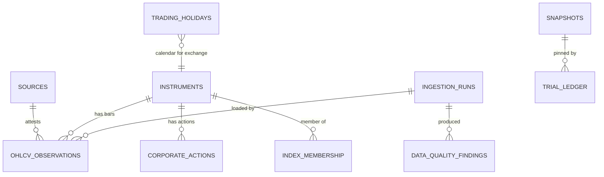
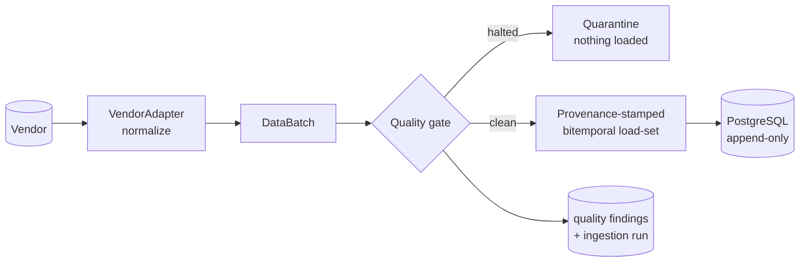

# Atlas — Data Architecture (Phase 2)

> **Status:** Ratified · Phase 2 (Data Foundation)
> **Last updated:** 2026-07-05
> **Owner:** Atlas Division (operating within Jarvis)
> **Related:** [point-in-time.md](point-in-time.md) · [market-data-model.md](market-data-model.md) · [data-quality.md](data-quality.md) · [reproducibility.md](reproducibility.md) · [../research/trial-ledger.md](../research/trial-ledger.md) · [../architecture/overview.md](../architecture/overview.md) · ADRs [0010](../adr/0010-phase-2-technology-stack.md)–[0014](../adr/0014-reproducibility-and-snapshots.md)

---

## 1. Purpose

This document is the master reference for Atlas's **source of truth**: the trustworthy, point-in-time, reproducible, quality-gated market-data layer that everything downstream depends on. It realizes the Phase-1 [Data Layer](../architecture/overview.md#31-data-layer) contract in concrete schemas and code.

**Phase-2 exit criteria** (from the [roadmap](../roadmap.md#phase-2--the-trustworthy-data-foundation)), each satisfied and tested:

| Exit criterion | Where it lives | Proof |
|---|---|---|
| Any historical query returns the world *as known then*, provably | [bitemporal core](../../src/atlas/data/bitemporal/) | `tests/unit/test_bitemporal.py`, `test_universe.py` |
| Data-quality gates halt bad/stale data | [quality gate](../../src/atlas/data/quality/) | `tests/unit/test_quality.py` |
| A vendor can be swapped behind the abstraction with no downstream change | [adapters](../../src/atlas/data/ingestion/adapters/) | `tests/reproducibility/test_reproducibility.py` |

## 2. Scope

**In scope (Phase 2):** NSE equities and indices — Nifty 50 / 100 / 200, India VIX, individual stocks — OHLCV, corporate actions, point-in-time snapshots, historical revisions, index membership, data lineage, the trial-ledger foundation, and the development/testing/CI foundation.

**Explicitly out of scope** (later phases): strategies, signals, backtesting engines, portfolio/risk engines, execution/brokers, AI prediction, dashboards ([system-boundaries](../architecture/system-boundaries.md)).

## 3. The pure-core / adapter architecture

The single most important structural decision ([ADR 0010](../adr/0010-phase-2-technology-stack.md)): the **domain core is pure standard library**; heavy dependencies live only in adapters.

```
            ┌────────────────────────── adapters (deps) ──────────────────────────┐
  vendors ─▶│ ingestion.adapters │        │ data.models (SQLAlchemy) │  cli/config │
            └─────────┬──────────┘        └────────────┬─────────────┘─────────────┘
                      │ normalized bars                │ persistence
            ┌─────────▼────────────────────── domain core (pure stdlib) ──────────▼┐
            │ common (time · hashing · ids · types)                                 │
            │ bitemporal · calendars · adjustments · universe · quality · snapshots │
            │ lineage · trials                                                      │
            └───────────────────────────────────────────────────────────────────────┘
```

Consequences: the core is testable with zero installs (CI's `core-no-deps` job proves it on Python 3.9 **and** 3.12), reproducible, and immune to any single library's churn over a decade — [principle 2.9](../principles.md#29-loose-coupling-and-replaceability).

## 4. Storage architecture

Two tiers, each chosen for its job ([ADR 0010](../adr/0010-phase-2-technology-stack.md)):

- **PostgreSQL — the system of record.** ACID, constraints, roles, append-only guarantees. Holds instruments, bitemporal OHLCV, corporate actions, index membership, calendars, ingestion runs, quality findings, the snapshot index, and the trial ledger. Schema in [`atlas.data.models`](../../src/atlas/data/models/tables.py); migrations in [`database/migrations`](../../database/migrations/).
- **Object storage + Parquet — immutable bulk & snapshots.** Raw vendor payloads (hashed, for tamper-evidence and reproducibility) and materialized snapshots as columnar Parquet, tiered hot/warm/cold for a decade of retention ([NFR §8](../architecture/non-functional-requirements.md#8-data-retention)). Local filesystem in dev, S3-compatible in prod, behind an abstraction.

**Least privilege ([ADR 0009](../adr/0009-threat-model-and-security-baseline.md)):** a writer role (ingestion) and a read-only research role are distinct DB principals; research can never mutate the source of truth.

## 5. The entity model



Every fact table with a knowledge-time axis (**OHLCV_OBSERVATIONS, CORPORATE_ACTIONS, INDEX_MEMBERSHIP**) is **bitemporal and append-only** ([§6](#6-the-bitemporal-backbone)). Full column-level schema: [`tables.py`](../../src/atlas/data/models/tables.py) and [market-data-model.md](market-data-model.md).

## 6. The bitemporal backbone

Point-in-time correctness is the spine of the whole layer ([ADR 0011](../adr/0011-bitemporal-point-in-time-model.md), deep dive in [point-in-time.md](point-in-time.md)):

- **Two axes** — *valid time* (what a fact is about) and *knowledge time* (when we learned it).
- **Append-only** — corrections insert a new version and close the old; the current version has `knowledge_to = FAR_FUTURE`.
- **As-of resolution** ([`asof.py`](../../src/atlas/data/bitemporal/asof.py)) returns the version known at *K*; future versions are invisible → no look-ahead.
- **Raw prices immutable; adjusted-on-read** from corporate actions known as-of *K*.
- **Survivorship-free universe** via bitemporal index membership.
- **DB-level enforcement** ([migration 0002](../../database/migrations/versions/0002_integrity_hardening.py)): append-only triggers make the fact tables truly immutable, `btree_gist` EXCLUDE constraints forbid overlapping knowledge intervals, and partial-unique indexes enforce one current version per fact. **Declarative `event_date` partitioning of OHLCV is a *planned* follow-up migration, not yet in place** (it recreates the table).

## 7. The ingestion pipeline

Vendor-agnostic, deterministic, idempotent, fail-safe ([`pipeline.py`](../../src/atlas/data/ingestion/pipeline.py)):



1. **Fetch & normalize** — the adapter turns vendor-native shapes into canonical `OHLCVBar`s. Two reference adapters with different native formats prove swap-equivalence.
2. **Validate** — the [quality suite](data-quality.md) runs; findings are recorded.
3. **Gate (fail-safe)** — any halting finding ⇒ the load-set is empty; **bad data never reaches the source of truth** ([ADR 0013](../adr/0013-data-quality-gating.md)).
4. **Stamp & load** — clean bars become bitemporal versions with `knowledge_from = knowledge_time`, provenance attached; persistence dedupes on `(key, knowledge_from)` (idempotent).

`knowledge_time` is **passed in**, not read from a clock, so a historical ingestion is exactly reproducible.

## 8. Reproducibility & lineage

- **Snapshots** ([ADR 0014](../adr/0014-reproducibility-and-snapshots.md)) — content-addressed, immutable materializations of an as-of query; a `snapshot_id` guarantees bit-identical inputs to a future backtest.
- **Provenance** on every artifact answers *which data, when collected, which source, reproducible?* ([reproducibility.md](reproducibility.md)).
- **Trial ledger** ([../research/trial-ledger.md](../research/trial-ledger.md)) — append-only, hash-chained record of every experiment; supplies the multiplicity denominator.

## 9. Security & audit alignment

Phase 2 has **no live capital and no broker**, so execution-side controls are N/A — but the data foundation already honours the [threat model](../architecture/threat-model.md):

- **Supply-chain** — hash-locked `uv.lock`, `pip-audit`, pinned deps ([ADR 0009](../adr/0009-threat-model-and-security-baseline.md)).
- **Secrets** — env/secret-manager only; `.env` git-ignored; `detect-secrets` in CI & pre-commit; no broker keys exist.
- **Market-data integrity** — cross-source corroboration is a first-class quality check; raw payloads are hashed.
- **Tamper-evidence** — the trial ledger is hash-chained (against in-place edits) with a `head_checkpoint()` for external-anchor truncation detection; fact tables are made append-only by DB triggers ([migration 0002](../../database/migrations/versions/0002_integrity_hardening.py)). External WORM anchoring of the checkpoint is a Phase-7 gate.
- **Least privilege** — a SELECT-only `atlas_reader` role and a DELETE-stripped `atlas_writer` role are created in migration 0002; wiring the read-only engine to research/reporting paths lands with the repository layer in a later phase.

## 10. What Phase 2 deliberately does *not* do

No live vendor is wired (adapters are deterministic mocks — a real vendor + its cross-source pair arrive with their own ADR); no scheduler/orchestrator is stood up (the pipeline is pure and CLI-invokable; Dagster/Prefect is a later choice); no API/dashboard exists. These are intentional — Phase 2 delivers *trustworthy data*, nothing more.

## 11. Map to code

| Concern | Module |
|---|---|
| Time authority, hashing, ids, types | [`atlas/common/`](../../src/atlas/common/) |
| Bitemporal / as-of | [`atlas/data/bitemporal/`](../../src/atlas/data/bitemporal/) |
| Instruments & OHLCV | [`atlas/data/market/`](../../src/atlas/data/market/) |
| Trading calendar | [`atlas/data/calendars/`](../../src/atlas/data/calendars/) |
| Corporate actions | [`atlas/data/adjustments/`](../../src/atlas/data/adjustments/) |
| Survivorship-free universe | [`atlas/data/universe/`](../../src/atlas/data/universe/) |
| Data quality | [`atlas/data/quality/`](../../src/atlas/data/quality/) |
| Snapshots / lineage | [`atlas/data/snapshots/`](../../src/atlas/data/snapshots/), [`atlas/data/lineage/`](../../src/atlas/data/lineage/) |
| Ingestion | [`atlas/data/ingestion/`](../../src/atlas/data/ingestion/) |
| Trial ledger | [`atlas/trials/`](../../src/atlas/trials/) |
| Persistence (SQLAlchemy) | [`atlas/data/models/`](../../src/atlas/data/models/) |
| Config / CLI | [`atlas/config/`](../../src/atlas/config/), [`atlas/cli/`](../../src/atlas/cli/) |
