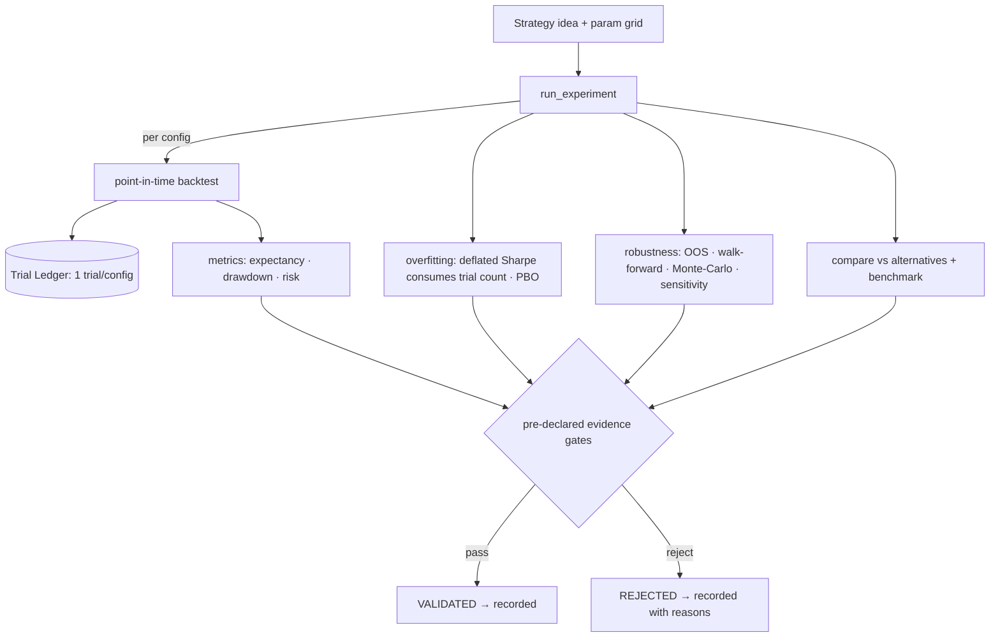

# Atlas — Research Workflow (Phase 3)

> **Status:** Ratified · Phase 3 · **Owner:** Atlas Division
> **Related:** [backtesting.md](backtesting.md) · [overfitting.md](overfitting.md) · [metrics-and-risk.md](metrics-and-risk.md) · [trial-ledger.md](trial-ledger.md) · [ADR 0016](../adr/0016-overfitting-policy-and-evidence-gates.md)

---

## 1. From idea to verdict — the funnel

Phase 3 turns *"I have a strategy idea"* into a recorded, defensible verdict. The [experiment runner](../../src/atlas/research/experiment.py) is the spine; it closes the two gaps the Phase-2 review flagged (leak-proof features; auto trial-ledger wiring).

## 2. How the eight goals are met

| Goal | Where |
|---|---|
| 1. Backtest it | [engine](../../src/atlas/backtest/engine.py) — point-in-time, cost-aware ([backtesting.md](backtesting.md)) |
| 2. Measure expectancy | [`expectancy`](../../src/atlas/backtest/metrics.py) — led, not win rate ([metrics-and-risk.md](metrics-and-risk.md)) |
| 3. Measure drawdown | [`drawdown`](../../src/atlas/backtest/metrics.py) — depth, duration, recovery |
| 4. Measure risk | vol, Sharpe, Sortino, Calmar, VaR/CVaR, tail |
| 5. Measure robustness | [validation](../../src/atlas/backtest/validation.py) — OOS, walk-forward, Monte-Carlo, sensitivity; the experiment runner now executes all four |
| 6. Detect overfitting | [overfitting](../../src/atlas/backtest/overfitting.py) — deflated Sharpe, PBO ([overfitting.md](overfitting.md)); all are part of the verdict |
| 7. Compare vs alternatives | [comparison](../../src/atlas/backtest/comparison.py) — risk-adjusted, vs benchmark |
| 8. Record in Trial Ledger | [experiment runner](../../src/atlas/research/experiment.py) — one trial per config, automatically |

## 3. Leakage prevention (closing Phase-2 gap #1)

Every strategy sees data only through the [leak-proof `DataView`](../../src/atlas/research/dataview.py) ([ADR 0017](../adr/0017-leak-proof-research-data-view.md)): strictly-before-decision-date access, so feature/label leakage is impossible by construction. The engine owns the raw source; strategy code only ever receives a view.

## 4. Honest multiplicity (closing Phase-2 gap #2)

The runner records **one trial per configuration** in the [trial ledger](trial-ledger.md), automatically — not by human diligence. So `family_trial_count` is the true number of things tried, and the [deflated Sharpe](overfitting.md) consumes it as the multiple-testing correction. Mining 1,000 configs raises the bar exactly as it should. The benchmark runs under its own family so it never inflates a strategy's trial count.

## 5. Evidence gates & the lifecycle

The verdict maps to the Phase-1 [strategy lifecycle](../architecture/domain-model.md#3-the-strategy-lifecycle) transition **Backtesting → Validated** (or → Rejected). Gates are **pre-declared** ([`EvidenceGates`](../../src/atlas/research/gates.py), [principle 3.3](../principles.md#33-evidence-gates-not-vibes-promote-strategies)) — committed before results are seen, so the bar cannot be moved to fit an outcome. The verdict, its reasons, and all metrics are written to the ledger as an append-only status change.

## 6. Reproducibility

Everything is deterministic given `(snapshot × params × seed × as_of)` — the same experiment reproduces the same result hashes, deflated Sharpe, and PBO ([ADR 0015](../adr/0015-backtesting-engine.md)), tested in `tests/reproducibility/`.

## 7. What "validated" does — and does not — mean

A `VALIDATED` verdict means the evidence cleared the pre-declared gates on *this snapshot* — it is **evidence, not a deployment decision**. Allocating capital is a later phase, gated by human approval, independent risk, and the [automated-trading charter](../automated-trading-charter.md). Validation is necessary, never sufficient.
